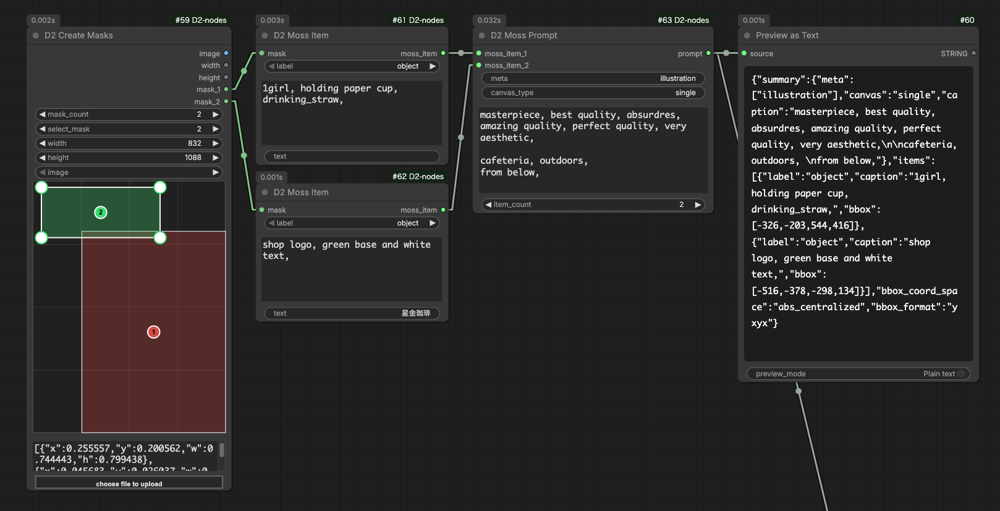

# D2 Moss Item / D2 Moss Prompt

<figure>
  
</figure>

- Nodes for building layout prompts (JSON format) for the image generation model [MOSS-Image](https://github.com/OpenMOSS/MOSS-Image)
- The area of a mask is used as the position (bbox) where an element is placed
- The bbox coordinates (pixel coordinates with the canvas center as the origin) are calculated automatically, so you don't need to calculate them by hand. The layout follows when you change the resolution
- Connect them in the order `D2 Create Masks` → `D2 Moss Item` → `D2 Moss Prompt`
- Layout prompts are an experimental feature of MOSS-Image, so only the fields described in the [USERGUIDE](https://github.com/OpenMOSS/MOSS-Image/blob/main/USERGUIDE.md) are supported

## D2 Moss Item

- Creates one element of the layout
- The rectangle that encloses the non-zero area of the mask becomes the bbox. If the mask is empty, the whole canvas becomes the bbox

### Input

- `mask`: Mask of the area where the element is placed
- `label`: Type of the element
    - `object`: Draw an object, a person, etc.
    - `text`: Draw text
- `caption`: Description of how the element looks (size, style, position, etc.)
    - You can comment out text the same way as in `D2 Prompt` (lines starting with `#` / `//`, `/*` … `*/`)
- `text`: The text to draw. Used only when `label` is `text`
    - To insert a line break, type `\n` or connect another node (such as `D2 Prompt`)

### Output

- `moss_item`: Data for one element. Connect it to `D2 Moss Prompt`

## D2 Moss Prompt

- Combines a description of the whole image and multiple `moss_item` inputs into a JSON string prompt

### Input

- `meta`: Tags describing the type of image. Multiple tags can be entered, separated by commas
    - Examples: `poster` / `photograph` / `illustration, anime`
- `canvas_type`: Usually leave it as `single`
- `summary_caption`: Description of the scene and art style of the whole image
    - Comments can be used the same way as in `caption`
- `item_count`: Number of `moss_item` inputs
- `moss_item_{number}`: Connect `D2 Moss Item`

### Output

- `prompt`: JSON string of the layout prompt. Connect it to a text encoder

> If `meta` / `canvas_type` / `summary_caption` are left empty, they are omitted from the JSON.
