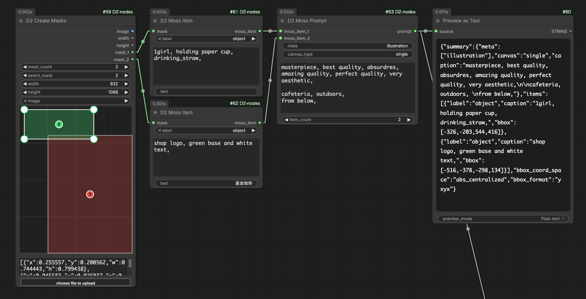

# D2 Moss Item / D2 Moss Prompt

<figure>
  
</figure>

- 画像生成モデル [MOSS-Image](https://github.com/OpenMOSS/MOSS-Image) のレイアウトプロンプト（JSON 形式）を作るノード
- マスクの範囲を、要素を置く位置（bbox）として使う
- bbox の座標（キャンバス中心が原点のピクセル座標）を自動で計算するので、手で計算する必要がない。解像度を変えても配置が追従する
- `D2 Create Masks` → `D2 Moss Item` → `D2 Moss Prompt` の順につないで使う
- MOSS-Image のレイアウトプロンプトは実験的機能なので、[USERGUIDE](https://github.com/OpenMOSS/MOSS-Image/blob/main/USERGUIDE.md) に書かれている項目だけに対応している

## D2 Moss Item

- レイアウトの要素1つ分を作る
- マスクの中で値のある範囲を囲む長方形を bbox にする。マスクが空のときはキャンバス全体を bbox にする

### Input

- `mask`：要素を置く範囲のマスク
- `label`：要素の種類
    - `object`：物や人物などを描かせる
    - `text`：文字を描かせる
- `caption`：要素の見た目の説明（大きさ・スタイル・位置など）
    - `D2 Prompt` と同じ書き方でコメントアウトできる（行頭の `#` / `//`、`/*` 〜 `*/`）
- `text`：描かせる文字。`label` が `text` のときだけ使う
    - 改行したいときは `\n` と入力するか、または他のノード（`D2 Prompt` など）を接続する

### Output

- `moss_item`：要素1つ分のデータ。`D2 Moss Prompt` に接続する

## D2 Moss Prompt

- 画像全体の説明と、複数の `moss_item` をまとめて JSON 文字列のプロンプトにする

### Input

- `meta`：画像の種類を表すタグ。カンマ区切りで複数入力できる
    - 例：`poster` / `photograph` / `illustration, anime`
- `canvas_type`：通常は `single` のままでよい
- `summary_caption`：画像全体のシーンや画風の説明
    - `caption` と同じくコメントアウトできる
- `item_count`：`moss_item` の入力数
- `moss_item_{数字}`：`D2 Moss Item` を接続する

### Output

- `prompt`：レイアウトプロンプトの JSON 文字列。テキストエンコーダーに接続する

> `meta` / `canvas_type` / `summary_caption` は、空欄にすると JSON から省略される。
