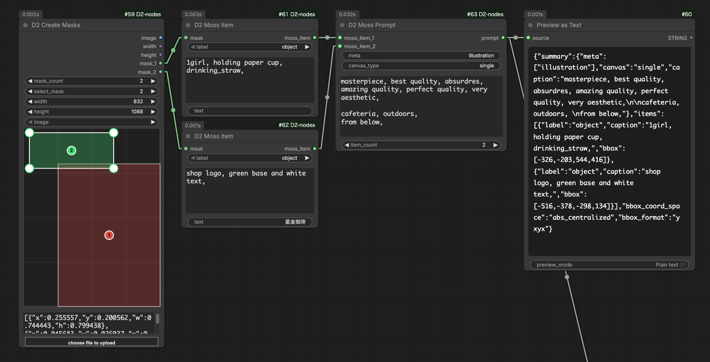

# D2 Moss Item / D2 Moss Prompt

<figure>
  
</figure>

- 為圖像生成模型 [MOSS-Image](https://github.com/OpenMOSS/MOSS-Image) 建立版面提示詞（JSON 格式）的節點
- 將遮罩的範圍作為放置元素的位置（bbox）
- 自動計算 bbox 的座標（以畫布中心為原點的像素座標），不需要手動計算。變更解析度時版面配置也會跟著調整
- 依 `D2 Create Masks` → `D2 Moss Item` → `D2 Moss Prompt` 的順序連接使用
- MOSS-Image 的版面提示詞是實驗性功能，因此僅支援 [USERGUIDE](https://github.com/OpenMOSS/MOSS-Image/blob/main/USERGUIDE.md) 中記載的項目

## D2 Moss Item

- 建立版面中的一個元素
- 以包圍遮罩中有值範圍的長方形作為 bbox。遮罩為空時，以整個畫布作為 bbox

### Input

- `mask`：放置元素範圍的遮罩
- `label`：元素的種類
    - `object`：繪製物品或人物等
    - `text`：繪製文字
- `caption`：元素外觀的說明（大小、風格、位置等）
    - 可用與 `D2 Prompt` 相同的寫法註解掉文字（行首的 `#` / `//`、`/*` 〜 `*/`）
- `text`：要繪製的文字。僅在 `label` 為 `text` 時使用
    - 想換行時請輸入 `\n`，或連接其他節點（如 `D2 Prompt`）

### Output

- `moss_item`：一個元素的資料。連接到 `D2 Moss Prompt`

## D2 Moss Prompt

- 將整張圖像的說明與多個 `moss_item` 整合為 JSON 字串的提示詞

### Input

- `meta`：表示圖像種類的標籤。可用逗號分隔輸入多個
    - 例：`poster` / `photograph` / `illustration, anime`
- `canvas_type`：通常維持 `single` 即可
- `summary_caption`：整張圖像的場景與畫風說明
    - 與 `caption` 相同，可以使用註解
- `item_count`：`moss_item` 的輸入數量
- `moss_item_{數字}`：連接 `D2 Moss Item`

### Output

- `prompt`：版面提示詞的 JSON 字串。連接到文字編碼器

> `meta` / `canvas_type` / `summary_caption` 留空時，會從 JSON 中省略。
